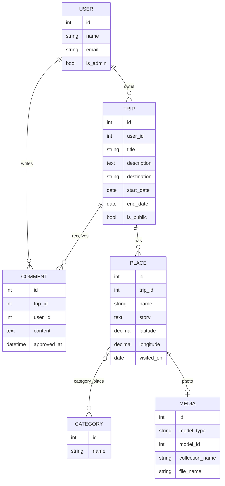

# Pinbook

**Pinbook is a travel journal.** Users write down their trips, pin the places they visited (with a photo, a position and categories), and share the trips they want to make public. Visitors can read the public trips and leave a comment once they are logged in; the owner of a trip moderates the comments.

Final project for *Modern Web Application 1* (Harbour.Space), built with Laravel 13 and PHP 8.5.

## What can you do?

| Who | What |
|---|---|
| **Visitor** (not logged in) | See the welcome page with the latest public trips, browse all public trips, open a trip and a place, browse the categories. |
| **User** (logged in) | Everything above, plus: create, edit and delete **my trips** and **my places** (with a photo and categories), comment on a trip, see and moderate (approve, edit, delete) the comments on my own trips, manage my profile. |
| **Admin** | Everything a user can do, on **all** trips, places and comments, plus management of the **categories**. |

Some rules worth knowing:

- A **private** trip (and its places) is not shown on the public pages at all; it only appears in the user zone of its owner (and of admins).
- A **new comment waits for approval**. Until then only its writer, the owner of the trip and admins can see it. The owner gets an email when someone comments.
- A place has one photo (jpg or png, up to 10 MB). It gets resized copies (thumbnail and details size); a place without a photo shows a default picture.
- The welcome page is cached for 10 seconds, so a new trip can take up to 10 seconds to appear there.
- The menu is defined once and shown in both the header and the footer of the public pages.

## Data structure



- **One-to-many:** User → Trip, Trip → Place, Trip → Comment, User → Comment.
- **Many-to-many:** Place ↔ Category (pivot table `category_place`).
- **Media** is the table of the Spatie Media Library (photos of places).

## How the code is organised

| Where | What |
|---|---|
| `routes/web.php` | Public routes, then the user zone under `/user` (needs login); category management also needs the `IsAdmin` middleware |
| `app/Http/Controllers/` | Public pages (read-only): welcome, trips, places, categories, posting a comment |
| `app/Http/Controllers/Userzone/` | Managing trips, places, comments (with a single-action controller to approve a comment) and categories |
| `app/Http/Requests/` | Form Requests with the validation rules and messages for trips and places |
| `app/Models/` | The models with their relationships, plus `canManage()` / `canView()` permission checks |
| `app/Http/Middleware/IsAdmin.php` | Only lets admins through |
| `app/Notifications/` | The queued "new comment on your trip" email |
| `public/css/pinbook.css` | The travel theme (colours, fonts, cards); Tailwind classes in the views handle the layout |
| `storage/seedings/places/` | The 30 demo photos used by the seeder (credits in `CREDITS.md`) |

## Installation

Requirements: **PHP 8.5** (with the `gd` extension), **Composer**, and **SQLite** (no database server needed). [Laravel Herd](https://herd.laravel.com) has all of this. No Node/npm is needed: without a build the pages load Tailwind CSS from a CDN.

```bash
# 1. Get the code
git clone https://github.com/Aye-Nyein-Thaw/pinbook.git
cd pinbook

# 2. Install the PHP packages
composer install

# 3. Create your environment file and the application key
cp .env.example .env
php artisan key:generate

# 4. Create the SQLite database file, then the tables and the demo data
touch database/database.sqlite
php artisan migrate:fresh --seed

# 5. Make the uploaded photos reachable from the web
php artisan storage:link
```

Then start the application, either with `php artisan serve` and open <http://localhost:8000>, or with Herd (put the folder in a Herd site, for example `pinbook.test`, and set `APP_URL` in `.env` to that address).

### Photo uploads up to 10 MB

The app accepts photos up to 10 MB, but PHP (and the web server) usually allow only 2 MB by default. Bigger uploads then fail with a validation error or "413 Request Entity Too Large". To allow them, raise these limits:

- `php.ini`: `upload_max_filesize = 10M` and `post_max_size = 12M`
- With Herd (nginx): `client_max_body_size 12M;` in Herd's nginx config, then restart Herd

### Emails and the queue

Emails (the "new comment" notification to the trip owner) are **queued**, and in development they are **written to the log** instead of being sent (`MAIL_MAILER=log`). To process the queue, run in a second terminal:

```bash
php artisan queue:work
```

Then open `storage/logs/laravel.log` to read the email. (For a quick test without a worker you can set `QUEUE_CONNECTION=sync` in `.env`.)

## Logins

All demo users have the password **`password`**.

| Email | Role |
|---|---|
| `admin@example.com` | admin |
| `admin@admin.com` | admin |
| `test@example.com` | normal user |

The seeder also creates 5 more random users, 8 categories, 15 trips, 30 places (each with a real photo from `storage/seedings/places`), and 120 comments (15 of them waiting for approval).

## Useful commands

```bash
php artisan migrate:fresh --seed   # reset the database with fresh demo data
php artisan test                   # run the Pest tests
vendor/bin/pint                    # fix the code style
```

## Built on

The Educational Starter Pack for Laravel from the course (Laravel 13, Breeze-style authentication, Pest, Debugbar), extended with [Spatie Media Library](https://spatie.be/docs/laravel-medialibrary) for the photos.

The demo photos (including the welcome and login backgrounds) come from Wikimedia Commons under CC BY / CC BY-SA / FAL licences; authors and links are listed in [`storage/seedings/places/CREDITS.md`](storage/seedings/places/CREDITS.md).
